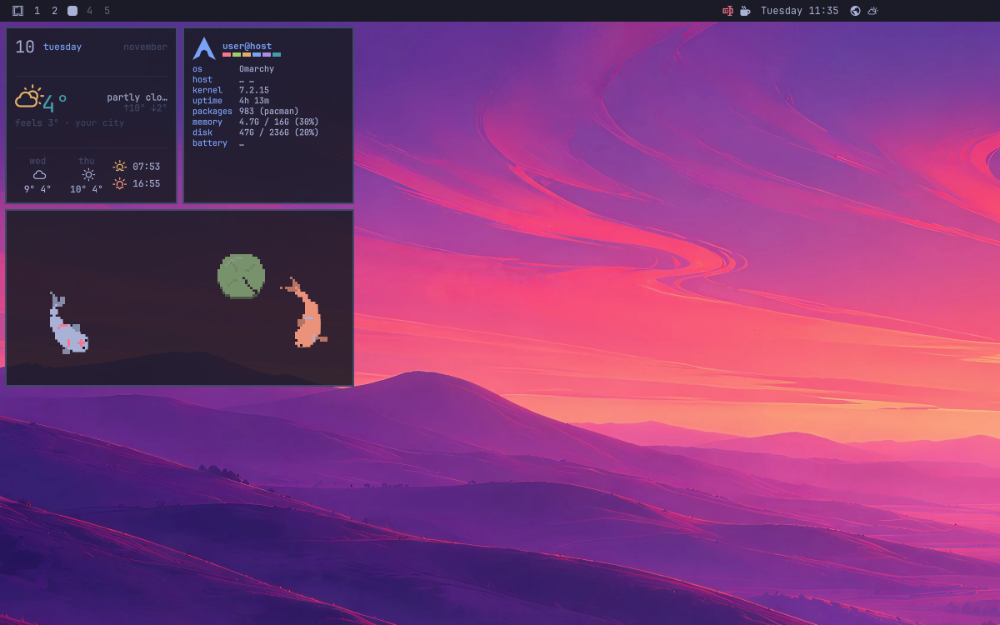

# omarchy-owl-desktop

- Puts [Omalauncher](https://github.com/SimonSchubert/omalauncher)'s OWL widgets on your [Omarchy](https://omarchy.org) desktop: over the wallpaper, under the windows, on the launcher's home-screen grid and in your current theme.
- Widgets are `.owl` files in `~/.config/omarchy-widgets`, drawn by the official [OWL runtime for Quickshell](https://github.com/SimonSchubert/omarchy-widgets/tree/main/runtimes/quickshell), so a widget that works on the phone works here unchanged.



## Install

```sh
curl -fsSL https://raw.githubusercontent.com/johannSo/omarchy-owl-desktop/main/install.sh | bash
```

This clones the repo to `~/.local/share/owl-desktop`, installs any missing packages, puts `owl-desktop` in `~/.local/bin`, adds it to Hyprland's autostart (`~/.config/hypr/autostart.lua`) so it starts with every session, and starts the widgets now. You can also run `./install.sh` from a clone. To skip a step, pass `--no-autostart` or `--no-start` (through curl: `| bash -s -- --no-autostart`).

To update, run `owl-desktop update` (or `update.sh`). It pulls the latest version and restarts the widgets if they're running, and leaves autostart as you set it.

To uninstall, pass `--uninstall` to `install.sh`. It stops the widgets, takes them out of autostart, and removes the command and the clone. Your widgets, style and layout stay.

Hold or right-click a widget to arrange the desktop. `owl-desktop help` lists the commands, and [docs/USAGE.md](docs/USAGE.md) explains everything else.

## How to contribute

- Open an issue or a pull request. Run your checkout in the foreground with `./bin/owl-desktop run` to see its log.
- Before a pull request, run `node test/layout.test.mjs` and `bash test/install.test.sh`. CI runs both, plus qmllint and shellcheck (see `.github/workflows/ci.yml` for the exact commands).
- `owl/` is the upstream runtime, vendored. Fix bugs in it at [SimonSchubert/omarchy-widgets](https://github.com/SimonSchubert/omarchy-widgets), and list any local change in `owl/PATCHES.md`.
- Send widgets to the store with `owl-desktop publish <file>`, not to this repo.

## ToDo

- [x] First run in a live Hyprland session.
- [x] Compare it with Omalauncher in screenshots: tiles, grid, error tiles and the screen panel.
- [x] Check that clicks between tiles still reach the wallpaper (double-click opens the picker).
- [x] Check that widgets pause behind tiled windows and that popups take input.
- [ ] Test with more than one monitor: per-monitor layouts and Next screen.
- [x] Add `install.sh --uninstall`.
- [x] Add CI that runs the tests, qmllint and shellcheck.
- [x] Add a screenshot to this README.

## License

MIT (see [LICENSE](LICENSE)). `owl/`, `bin/omarchy-widgets` and `starter/` are by Simon Schubert, also MIT; see `owl/LICENSE` and `bin/LICENSE.omarchy-widgets`.
